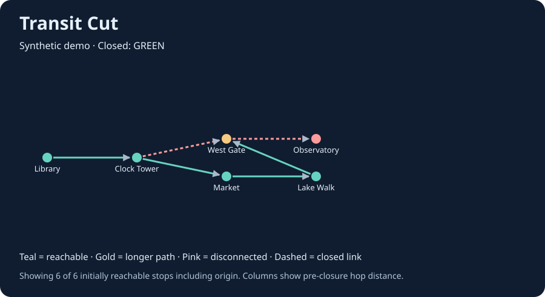
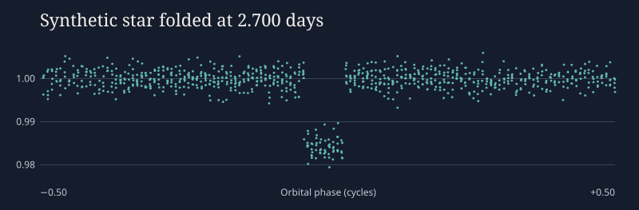
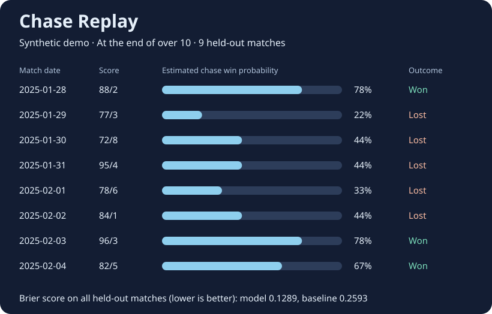

# 10 Python Projects

Eight students request the last lab seat at the same instant. A bus route closes but some passengers still have a way home. A game averages 69 FPS and stutters anyway. This collection turns ten questions like these into small, reproducible Python experiments.

**Start with [SeatRace](seat-race/) for backend engineering, [Transit Cut](transit-cut/) for algorithms, or [Transit Fold Lab](transit-fold/) for scientific computing.** Each project has its own source, tests, sample input or generator, and instructions for trying a different input. The demos run offline.



## Choose a project

| Project | Run the experiment | Skills on display |
|---|---|---|
| [SeatRace](seat-race/) | Race eight requests for one seat. Cancel the winning reservation and check who moves up. | SQLite transactions, concurrency testing, FIFO queues |
| [Transit Cut](transit-cut/) | Close a route. Find the stops that lose service and those still reachable via a detour. Accepts real GTFS feeds. | Graph traversal, relational data, before/after analysis |
| [ReplayDesk](replay-desk/) | Fail a shipment update mid-transaction, send it again and inspect the ledger. | Idempotency, rollback, reliable event processing |
| [FrameBudget](frame-budget/) | Inspect a game capture frame by frame to locate a hitch and an eight-frame slowdown. | Tail latency, percentiles, HTML reports |
| [Contract Diff](contract-diff/) | Change a ticket API's spec and see which requests or responses could break an existing client. | OpenAPI, compatibility rules, CI exit codes |
| [Chase Replay](chase-replay/) | Estimate a T20 chase at the ten-over break and score the predictions on later matches. | Nearest neighbors, chronological evaluation, Brier score |
| [CI Retry](ci-retry/) | Compare repeated test runs. Identify an inconsistent reservation test and distinguish it from a fix on a later commit. | JUnit XML, test reliability, CI analysis |
| [Transit Fold Lab](transit-fold/) | Recover a hidden period from noisy star brightness data, then change it in the interactive viewer. | Signal processing, simulation, experimental controls |
| [Search Bench](search-bench/) | Change the search ranking for a campus handbook and measure when the right document moves up. | SQL full-text search, HTTP API, retrieval evaluation |
| [BatchProof](batch-proof/) | Reconcile two CSVs that both total ₹800 and find the two invoices with incorrect amounts. | Data quality, integer money arithmetic, exception handling |

## Run the collection

Use Python 3.11 or newer with SQLite FTS5 support. No package installation or API keys are needed for the bundled examples. From the repository root:

```sh
python check.py
python seat-race/seat_race.py race --students 8 --seats 1
python transit-cut/transit_cut.py
python search-bench/search_bench.py eval
```

The test runner executes each project's suite independently. The GitHub Actions configuration runs the same command on Python 3.11 and 3.14. Individual READMEs document custom inputs and known limits. A project directory can also be used on its own.

## Two more demos

**Astronomy.** A simulated star dims every 2.700 days. The scanner estimates that period across an observing gap. Generate the local HTML report to see how an incorrect period scatters the points.



**Cricket.** Each point below is an out-of-sample forecast for a fictional match. The importer also accepts Cricsheet match archives. The baseline gives every test match the earlier training matches' win rate.



## Why these skills

The selection reflects Indian internship descriptions reviewed on 20 November 2026. RevRag's Bengaluru backend role emphasizes databases, APIs and debugging. Tekravio's Python backend/data and analyst roles emphasize tested Python, SQL, pipelines and inspectable projects. Agoda's 2027 Gurgaon software engineering internship describes work on APIs, testing and continuous integration. The examples are independently authored learning projects. The job descriptions informed the choice of engineering problems.

[RevRag backend internship](https://www.revrag.ai/careers/software-developer-intern-backend) · [Tekravio internships](https://tekravio.com/careers) · [Agoda engineering internship](https://job-boards.greenhouse.io/agoda/jobs/6323041)
