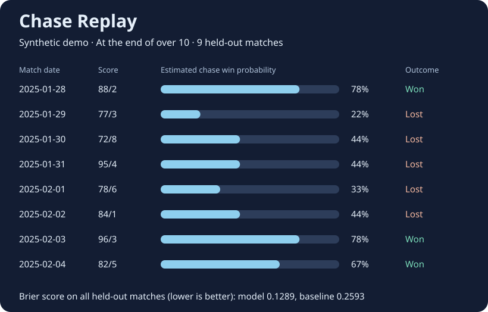

# Chase Replay

At the ten-over break, what chance does the chasing side have? This small, inspectable T20 model compares the current chase to earlier matches, then measures its errors against a simple baseline on later matches.



## Try it

Python 3.9+ and its standard library are sufficient. From this directory:

```sh
python chase_replay.py
python chase_replay.py --svg forecasts.svg
python chase_replay.py --over 15 --neighbors 5 --csv predictions.csv
python -m unittest discover -v
```

The bundled seeded generator creates 36 fictional T20 records in memory using the relevant Cricsheet JSON fields. Both the demo and real imports follow the same parsing and evaluation path. Numbers from the demo describe these fictional fixtures only.

## Replay real matches

Get the JSON ZIP for the [Indian Premier League or Women's Premier League from Cricsheet](https://cricsheet.org/downloads/). Keep leagues separate for an easier-to-interpret comparison. Point the CLI at a local ZIP or directory with match files directly inside.

```sh
python chase_replay.py --data ipl_json.zip --over 10 --csv held-out.csv
```

The example filename is a placeholder for your downloaded ZIP. If sharing results or redistributing match files, credit Cricsheet and follow [Cricsheet's data terms](https://cricsheet.org/matches/). No third-party match files are bundled.

## How the forecast works

1. Choose a completed over, from 1 to 19. Collect one snapshot per match with play continuing after that break. Count runs on all deliveries, and exclude retired-hurt events from wickets lost.
2. Reserve the last quarter of distinct match dates, rounded up, for testing, keeping same-day matches together. Train on earlier dates only.
3. Compare runs required per over and wickets lost. For this simple distance function, one wicket has the same weight as two required runs per over. Among the seven nearest training matches, add one virtual win and one virtual loss to reduce overconfident estimates. One can adjust the neighbor count.
4. Print both Brier scores: the mean squared difference between each predicted probability and the actual binary outcome. The baseline always predicts the training set's chase win rate. A lower score is better, and the model can lose to the baseline.

The evaluation excludes shortened or method-adjusted contests, ties, nonstandard formats, and chases over before the checkpoint. The inclusion rules mean this is a retrospective benchmark conditional on standard, resolved matches. It ignores player strength, venue, power-play effects and wickets that can return after retiring hurt. Forecasts are illustrative and uncalibrated. Avoid choosing `--over` or `--neighbors` on the final test score when reporting generalization.
