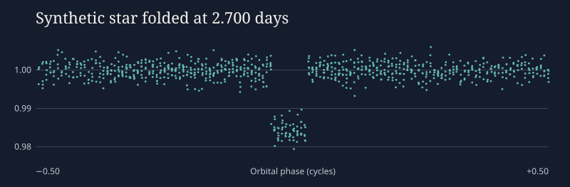

# Transit Fold Lab

Find a repeating dip in a star's brightness, then move the period slider away from the best fit and watch the alignment dissolve. The Python scanner and the interactive HTML report run offline with the standard library.



## Run the experiment

From this directory, run:

```sh
python transit_fold.py
python -m unittest discover -v
```

Open `transit-report.html` in a browser. The report includes the raw observations, folded measurements, a binned mean and the score across the search grid. Arrow keys step through the trial periods when the slider has focus. **Best fit** restores the winning period.

| Default experiment | Measured result |
| --- | --- |
| 18 simulated days with an observing gap, seed 17 | 840 observations |
| Injected period 2.700 days, flux drop 0.016 | Best grid period **2.700 days**, estimated drop **0.01405** |
| Search between 1.5 and 4 days | 251 trial periods, 0.01-day spacing |

## Bring a light curve

```sh
python transit_fold.py --csv curve.csv --min-period 1 --max-period 3 --steps 401 --output my-curve.html
```

Use UTF-8 CSV with headers `time_days,flux`. Time must be in days and higher flux must mean brighter. Supply finite numeric values, at least 20 observations and a time span of at least twice the longest trial period. Flux can use any consistent linear unit. Prepare, quality-filter and detrend real observations before importing them. The CLI validates the headers and reports the line number for malformed measurements.

## What the score means

The scanner folds the times modulo each trial period, splits the orbit into 80 bins and slides a dimming window around the phase circle. Four window widths represent 2.5%, 5%, 7.5% and 10% of an orbit. It compares the mean flux inside and outside each window. The score is the drop in squared residuals relative to fitting a single constant brightness. Pre-binning lets many phase windows share the same pass over the observations.

The default signal uses a rectangular dip with white noise and an observing gap. The grid quantizes period and duration. The highest-scoring period may be a harmonic, an observing artifact or a chance dip. The score carries no calibrated false-alarm probability, and the scanner does not model limb darkening, use per-sample uncertainties or establish the existence of a planet. The tests include an exactly flat control and matched noisy curves with and without an injection.

**Interview exercise.** Shift the injection period halfway between grid points. Compare recovery at 51 and 501 trial periods and explain how compute time and period resolution change. Try a period beyond the grid and inspect the resulting aliased peak.

**Scientific references.** NASA describes the physical transit method. Astropy documents a full box least-squares model with uncertainty handling and configurable durations. These references inform the simplified implementation here. [NASA transit method](https://science.nasa.gov/exoplanets/how-we-find-and-characterize/#transits-planets-found-in-dips-in-light) · [Astropy box least squares](https://docs.astropy.org/en/stable/timeseries/bls.html)
